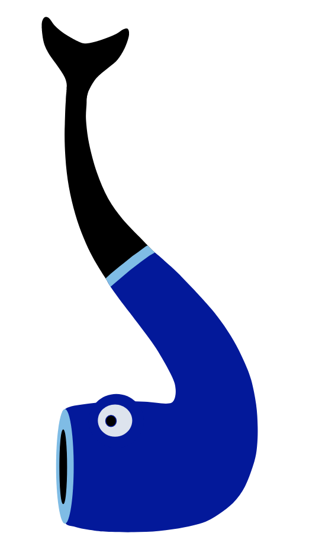

# 🧿 Pipefish

## Welcome to Pipefish!

Pipefish is a delightful general-purpose language particularly suitable for rapid development of CRUD apps, middleware, distributed servivces, and DSLs to wrap them in. With the semantics of a functional language, with syntax borrowed from mainstream productivity languages (specifically Python and Go), and with [inspiration mainly from SQL and Excel](https://github.com/tim-hardcastle/pipefish/blob/main/docs/pipefish-a-high-level-view.md) — Pipefish is not *quite* like anything you've ever seen. But it is also a very practical language that exists to solve some very ordinary "white-collar" problems.

The core language is 97% feature-complete; it currently has [41 standard libraries](https://github.com/tim-hardcastle/pipefish/wiki/Imports-and-libraries#libraries); there is [tooling](https://github.com/tim-hardcastle/pipefish/wiki/Developing-in-Pipefish); there is [a wiki](https://github.com/tim-hardcastle/pipefish/wiki); there are plenty of features including some you've never heard or thought of.

It benchmarks very competitively on [independent benchmarks](https://github.com/lac-dcc/BenchGen/wiki/Pipefish:-A-functional-and-indentation-sensitive-programming-language-on-BenchGen), despite having little in the way of optimization (scheduled for the next phase of the project).

It still requires work on optimzation, tooling, concurrency, and security before it should be used in production for its main purpose, but it can be used for personal projects. You can download it [here](https://github.com/tim-hardcastle/pipefish/wiki/Installing-and-using-Pipefish).

It is intended that Pipefish itself will one day be used in productionI, or alternatively that this project will get enough attention that my ideas will be copied by people with more money and personnel and expertise, and that, if not Pipefish, then some Pipefish-style language will one day make people's lives easier. To this end, please add a star to the repo! Thank you!

Instructions for installing Pipefish can be found [here](https://github.com/tim-hardcastle/pipefish/wiki/Installing-and-using-Pipefish), as part of [a general manual/tutorial wiki](https://github.com/tim-hardcastle/pipefish/wiki) that tells you everything you need to know to code in Pipefish. There are [lots of other supporting documents](https://github.com/tim-hardcastle/pipefish/tree/main/docs).

## A little Pipefish

Here is some sample code: you should find it readable.

  

## Distinguishing features

Here are some of Pipefish's more distinctive features:

* Pipefish services have a [functional core, imperative shell](https://github.com/tim-hardcastle/pipefish/blob/main/docs/functional-core-imperative-shell.md) architecture, in which a thin layer of IO sits on top of pure functional business logic.
* All values are immutable; all comparison is by value.
* Functions are pure and referentially transparent.
* [Local variables](https://github.com/tim-hardcastle/pipefish/wiki/Local-variables-and-inner-functions#local-constants) of functions are defined in a block at the end of the function and evaluated only if/when required. (You don't know how nice this is until you've tried it.)
* Free order of intitialization also helps you to write your scripts top-down.
* Abstraction is achieved by [overloading](https://github.com/tim-hardcastle/pipefish/wiki/Function-signatures-and-overloading#overloading) and duck-typing. There is multiple dispatch.
* Field names of [structs](https://github.com/tim-hardcastle/pipefish/wiki/Structs) are first-class objects. Indexing structs and maps overloads the same operator.
* While Pipefish is very dynamic (as illustrated in the previous two points) it is also very strongly typed, much more so than any mainstream dynamic language, and is largely compile-time checkable. A rich, expressive type system offers you parameterized types, interfaces, clone types, and more.
* Pipefish is REPL-oriented, with [livecoding](https://github.com/tim-hardcastle/pipefish/wiki/Livecoding) to make it easy to code and test incrementally.
* The REPL is also a [development environment](https://github.com/tim-hardcastle/pipefish/wiki/Developing-in-Pipefish) and [framework](https://github.com/tim-hardcastle/pipefish/wiki/Client-and-server). It lets you test your code, write permanent tests, ask for help, interact with error messages, configure your services, deploy them to the web and manage access to them.
* It is intended that often a Pipefish service will act as its own front end (like e.g. a SQL database does) with the end-user talking to it via the Pipefish REPL. For this reason Pipefish has an unusually [flexible syntax](https://github.com/tim-hardcastle/pipefish/wiki/Infixes,-postfixes,-etc) for creating DSLs.
* Pipefish comes with [Go](https://github.com/tim-hardcastle/pipefish/wiki/Golang-interop) and [SQL](https://github.com/tim-hardcastle/pipefish/wiki/The-database-sql-library) interop for all your backend needs.
* (Also the [system for embedding other languages](https://github.com/tim-hardcastle/pipefish/wiki/Snippets) is extensible if this does not in fact meet all your needs.)
* Pipefish allows you to deploy your libraries as [microservices](https://github.com/tim-hardcastle/pipefish/wiki/Microservices), or, alternatively to turn your microservices back into libraries.
* Pipefish’s syntax is based on mainstream productivity languages, principally Python and Go. It has a shallow or indeed invisible learning curve: you can learn the simple parts of the language without knowing that the other parts exist.
* Pipefish's roadmap includes a point where we freeze the core language around a small set of sufficiently powerful features and try to remain permanently in version 1.x.

## Documents

* [The Pipefish manual/wiki](https://github.com/tim-hardcastle/pipefish/wiki). A complete guide to coding in Pipefish.
* [Pipefish: a high-level view](https://github.com/tim-hardcastle/pipefish/blob/main/docs/pipefish-a-high-level-view.md). This explains the goals and design principles of the language.
* [Style guide](https://github.com/tim-hardcastle/pipefish/blob/main/docs/style-guide.md). This gives best practices for the style in which one should write Pipefish code.
* [Functional core, imperative shell](https://github.com/tim-hardcastle/pipefish/blob/main/docs/functional-core-imperative-shell.md). A synopsis of the language paradigm.
* [Pipefish and the lambda calculus](https://github.com/tim-hardcastle/pipefish/blob/main/docs/pipefish-and-the-lambda-calculus.md). A quick look at the fact that Pipefish is the lambda calculus with a ton of sugar poured on it.
* [Architecture of Pipefish](https://github.com/tim-hardcastle/pipefish/blob/main/docs/architecture.md). This explains broadly how the initializer/compiler/VM work. 
* [Pipefish for Gophers](https://github.com/tim-hardcastle/pipefish/blob/main/docs/for-gophers.md). This explains the relationship between Go and Pipefish for people who already know Go.
* [The whys of Pipefish](https://github.com/tim-hardcastle/pipefish/blob/main/docs/the-whys-of-pipefish.md). This explains the reasoning behind some lower-level design choices which are sufficiently unusual as to need explanation.

## Our adorable mascot

According to Rob Pike, every language needs an adorable mascot. This is our adorable mascot, René the pipefish.

  

Pipefish may also be symbolized by the nazar emoji: 🧿

## Licensing

🧿 Pipefish is distributed under the MIT license. Please steal my code and ideas.
